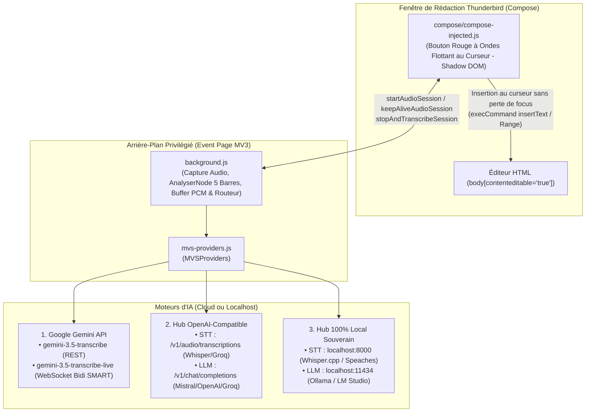
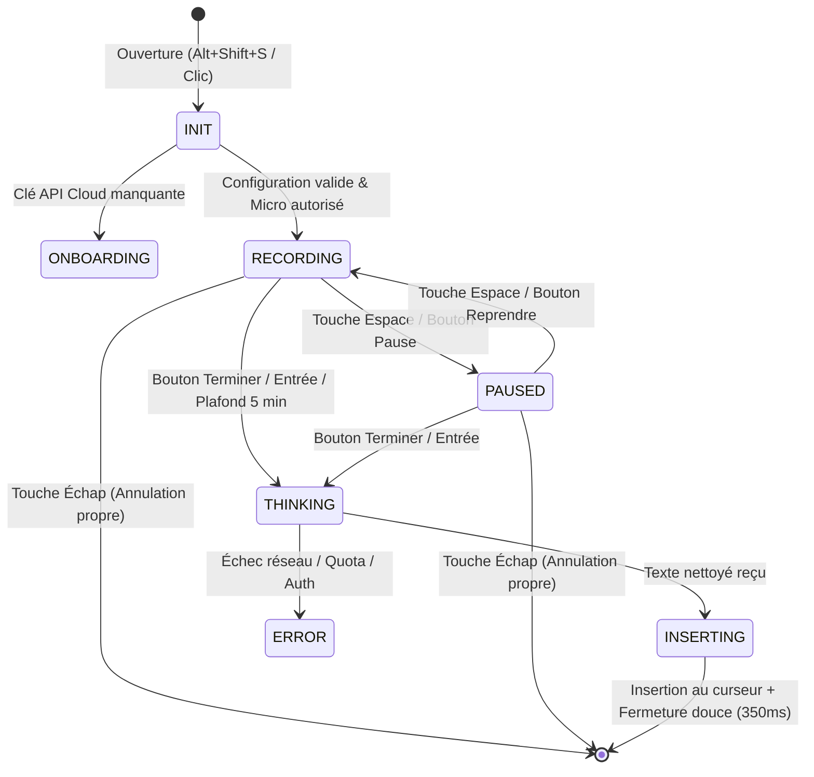

# ARCHITECTURE.md — Magic Voice Scriber (Thunderbird Edition)

Ce document décrit l'architecture technique interne, les flux de données et les choix d'ingénierie de **Magic Voice Scriber** pour Thunderbird 128+ ESR (Manifest V3).

---

## 1. Vue d'Ensemble du Système

**Magic Voice Scriber** est une WebExtension Manifest V3 pure en Vanilla JavaScript (zéro bundler, zéro dépendance externe, zéro Experiment API). Elle associe un **bouton flottant à ondes blanches injecté au curseur** (`compose/compose-injected.js`) à un moteur de capture audio microphone et d'orchestration réseau multi-moteurs dans l'Event Page (`background.js`, `mvs-providers.js`).



---

## 2. Structure des Fichiers

```text
magic-voice-scriber-thunderbird/
├── manifest.json                  # Manifeste WebExtension MV3 (Thunderbird >= 128.0)
├── background.js                  # Event Page : capture micro, 5 barres d'ondes, streaming Live, KeepAlive
├── mvs-providers.js               # Orchestrateur des 3 familles de moteurs IA + prompts Rambler
├── compose/
│   ├── compose-injected.js        # Bouton rouge à ondes blanches flottant à côté du curseur (Shadow DOM)
│   ├── compose.html               # Structure de la capsule
│   ├── compose.css                # Styles glassmorphism
│   └── compose.js                 # Logique du widget
├── options/
│   ├── options.html               # Interface de paramétrage multi-fournisseurs
│   ├── options.css                # Styles de la page d'options
│   └── options.js                 # Logique de configuration, presets et test de connexion
├── icons/                         # Icônes PNG détourées Alpha (16, 32, 48, 64, 128)
├── _locales/                      # Dictionnaires i18n (en, fr, es, pt, de, vi)
├── test/
│   └── mvs.test.js                # Suite de tests unitaires automatisés (Node.js test runner)
├── build.sh                       # Script de packaging .xpi vers dist/ avec garde-fou DEBUG
└── icon.png                       # Icône officielle 128x128
```

---

## 3. Machine à États de la Capsule (`compose/compose.js`)



---

## 4. Détail des 3 Pipelines d'Intelligence Vocale (`mvs-providers.js`)

### 4.1 Pipeline 1 : Google Gemini (Par défaut)
- **`gemini-3.5-transcribe` (REST)** :
  - Envoie le blob audio encodé en Base64 dans `contents[0].parts[0].inlineData` accompagné de l'instruction du mode de voix (`natural`, `pro`, `bullets`) et de `generationConfig.audioTranscriptionConfig.mode = "SMART"`.
  - Avantage : Traitement en **une seule passe** (transcription + suppression des hésitations + auto-corrections + structuration).
- **`gemini-3.5-transcribe-live` (WebSocket)** :
  - Établit une session WebSocket sur `wss://generativelanguage.googleapis.com/ws/google.ai.generativelanguage.v1alpha.GenerativeService.BidiGenerateContent`.
  - Envoie le message initial `setup` avec `model: "models/gemini-3.5-transcribe-live"`, `responseModalities: ["TEXT"]` et `inputAudioTranscription: { mode: "SMART" }`.
  - Diffuse des tranches audio PCM 16 kHz (`audio/pcm;rate=16000`) et affiche les fragments transcrits en temps réel.

### 4.2 Pipeline 2 : OpenAI / Tiers Cloud (Mistral, Groq, OpenAI)
1. **Étape STT** : Requête `POST` en `multipart/form-data` vers `/v1/audio/transcriptions` (OpenAI `whisper-1` ou Groq `whisper-large-v3-turbo`).
2. **Étape LLM (Nettoyage Rambler)** : Requête `POST` JSON vers `/v1/chat/completions` avec un prompt système strict adapté au mode sélectionné (`natural`, `pro`, `bullets`) et `temperature: 0.2`.

### 4.3 Pipeline 3 : Modèle Local Souverain (Ollama / LM Studio + Whisper Local)
1. **Étape STT Locale** : Requête `POST` vers `http://localhost:8000/v1/audio/transcriptions` (compatible `faster-whisper-server`, `speaches`, `whisper.cpp`).
2. **Étape LLM Locale** : Requête `POST` vers `http://localhost:11434/v1/chat/completions` (Ollama) ou `http://localhost:1234/v1/chat/completions` (LM Studio).
- Toutes les requêtes HTTP transitent par `background.js` afin de s'affranchir des restrictions CORS du navigateur.

---

## 5. Insertion Chirurgicale et Pagination dans l'Éditeur Thunderbird

Lors de l'état `INSERTING`, `compose.js` exécute un script dans l'onglet de rédaction via `browser.scripting.executeScript` :
1. Redonne le focus à l'éditeur `body[contenteditable='true']`.
2. Convertit et insère le texte nettoyé à la position exacte du curseur via `document.execCommand("insertText", false, texte)` afin de conserver l'historique d'annulation natif (`Ctrl+Z`).
3. En cas d'indisponibilité de `execCommand`, utilise un repli basé sur `window.getSelection().getRangeAt(0)` en générant des nœuds DOM sûrs (`createTextNode` et `<br>`).

---

## 6. Sécurité & Conformité CSP MV3

- **Zéro injection HTML non sanitisée** : Aucune utilisation de `innerHTML`, `outerHTML` ou `insertAdjacentHTML`.
- **Zéro exécution dynamique** : Aucune utilisation de `eval()` ou `new Function()`.
- **Zéro dialogue bloquant** : Aucune utilisation de `window.alert()`, `confirm()` ou `prompt()`.
- **Validation de l'expéditeur** : `background.js` vérifie systématiquement `expediteur.id === browser.runtime.id`.
